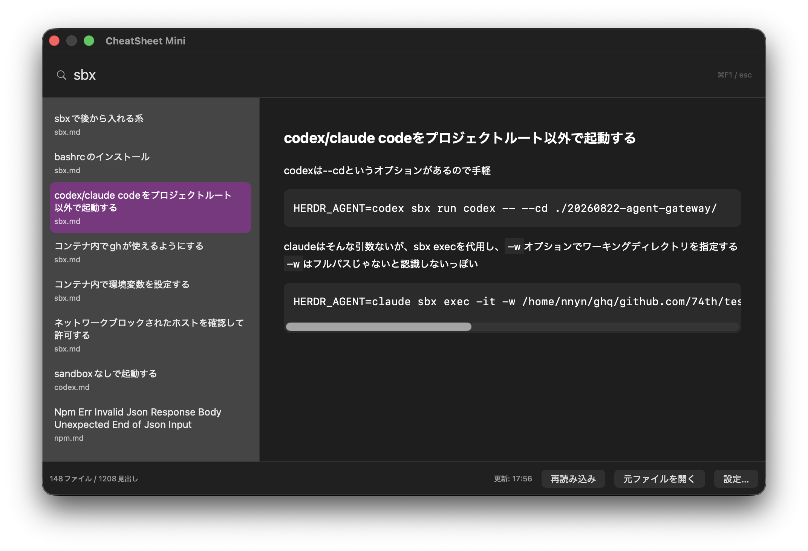

# CheatSheet Mini

ローカルMarkdownを `##` 見出し単位で検索するmacOSメニューバーアプリです。




## 必要環境

- macOS 13以上
- XcodeとCommand Line Tools (`xcode-select -p`)
- 初回ビルド時にGitHubへ接続できること（SwiftPMがOSSの[Down](https://github.com/johnxnguyen/Down)を取得するため）

## 起動

```bash
cd CheatSheetMini
./build-app.sh
```

SwiftPMがDownの依存関係を取得し、`dist/CheatSheet Mini.app` を作成して起動します。
Xcodeでは `Package.swift` を開き、ソースを閲覧・編集できます。
起動せずビルドだけ行う場合は `./build-app.sh --no-open` を使用します。

## 操作

1. 初回起動時にMarkdownを保存したフォルダを選ぶ（試用時は `SampleDocs`）。
2. 既定のCmd+F1（⌘F1）で検索ウィンドウの表示・非表示を切り替えます（他のウィンドウの背面にあるときは前面に表示します）。ウィンドウ外をクリックしても消えず、Escで閉じても再表示時は前回の検索語と表示中のページが残ります。機種やシステム設定によってはCmd+Fn+F1が必要です。
3. `sbx` と入力すれば sbx.md の見出しを列挙します。
4. `sbx.codex` と入力すればファイル名 sbx と見出し codex の双方で絞り込みます。
5. 左の候補を選択すると、右側にその `##` 見出しから次の `##` の手前まで表示します。候補リストとドキュメントの幅は約3:7で、ウィンドウの幅を変更してもこの比率を保ちます。
6. Escでパネルを閉じます。メニューバーの文鳥＋本アイコンからも表示できます。
7. 「元ファイルを開く」ボタンと検索欄のEnterで、元の `.md` ファイルを開きます。設定画面で起動コマンドを指定していなければ既定アプリを使います。

## 設定

検索欄と設定の入力欄では⌘X（切り取り）・⌘C（コピー）・⌘V（ペースト）・⌘A（すべて選択）を使えます。右側のドキュメント本文やコードをマウスでドラッグして範囲選択し、⌘Cでコピーできます。

検索テキストを変更すると、候補リストの選択とスクロール位置を先頭に戻します。検索欄で↓を押すと、現在選択中の候補を維持して候補リストへフォーカスを移し、続けて↑↓で候補を移動できます。日本語の変換中は変換候補の操作を優先し、検索結果が空なら検索欄にとどまります。

検索パネルの⌘Wは検索語をクリアし、候補を先頭に戻して検索欄へフォーカスを移します。パネルは開いたままです。設定画面の⌘Wは設定ウィンドウを閉じます。今回の確認範囲は [検証記録](openspec/changes/archive/2026-10-12-enable-edit-shortcuts-and-clear-search/verification.md) を参照してください。

メニューバーまたは検索ウィンドウ右下の「設定…」で、現在のフォルダ、呼び出しキー、元ファイルを開くコマンドを確認・変更できます。設定を開くと検索ウィンドウは非表示になります。

- フォルダはパス入力（`~`も可）または「選択…」で編集し、「フォルダを適用」で反映します。空入力・個別ファイル・存在しない／読めないフォルダはエラーになります。検証やbookmark生成の失敗時は旧フォルダと検索結果を保持します。
- キーの記録ボタンを押して組み合わせを入力し、「キーを適用」で反映します。Command・Option・Control・Shiftを使え、修飾なしはF1〜F20に限ります。記録中は現在のグローバルキーを一時解除し、入力終了・Esc／キャンセル・画面を閉じる際に復元します。復元失敗は設定画面に表示します。
- 項目ごとに適用します。適用せず閉じた編集は破棄されます。新キーの登録失敗時は旧キーと保存値を保持します。
- フォルダを変更した場合だけ索引を再構築します。同一フォルダの再適用・設定画面の表示・キー変更ではスキャンしません。
- フォルダは従来の `folderBookmark` のキー・形式を継続して保存・復元します。旧版の設定を引き継ぎます。キー未保存時は更新後もCmd+F1になります。
- 検索欄の `name.title` は入力例のプレースホルダーです。`name` は拡張子なしのファイル名、`title` は `##` 見出しを表します。再表示時の検索文字列は空です。

ビルド・自動テストと実機操作の確認範囲は [検証記録](openspec/changes/archive/2026-10-12-add-search-settings/verification.md) を参照してください。実装済み機能と実機検証済みの動作は区別しています。

### 元ファイルを開くコマンド

設定画面の「元ファイルを開くコマンド」に `code $file` と入力して「コマンドを適用」を押すと、以後はVS Codeで元Markdownを開きます。CLIがPATHから見つからない場合は、`"/Applications/Visual Studio Code.app/Contents/Resources/app/bin/code" $file` のように実行ファイルの絶対パスを指定してください。VS Codeの`code`コマンド自体がない場合は、VS CodeでShell Commandのインストールも必要です。

`$file` は元Markdownの絶対パスを表し、空白や日本語を含む場合も1個の引数として渡します。`"$file"` でも指定できます。空白区切りと単一・二重引用符だけに対応し、`$file` は引数全体として1回必要です。パイプ、リダイレクト、セミコロン、コマンド置換、他の変数展開は使用できません。設定にエラーがあれば検索パネルに理由を表示します。

入力欄を空にして「コマンドを適用」を押すとmacOSの既定アプリに戻ります。設定は他の項目と同様にアプリ内へ保存され、適用後すぐに反映されます。適用せずに設定画面を閉じた編集は破棄されます。

## 更新仕様（指定に合わせて固定）

- **60分ごと**に直下の `.md` ファイル一覧をスキャン
- **設定済みショートカットやメニューで検索を呼び出してもスキャンしない**
- **サブフォルダは検索対象外**
- 起動時に全ファイルを読み込み
- 変更のないファイルは前回の解析結果を再利用
- ファイル追加、変更、削除に対応
- スリープ中はタイマーを保証しません。アプリ起動時のスキャンで回復します
- すぐ更新したい場合だけメニューの「今すぐ再読み込み」またはパネル下部の「再読み込み」を使用

## Markdownと画像

- `## ` (ATXレベル2) 見出しだけを検索索引として使用
- バッククォート/チルダのフェンス内の `##` は見出し扱いしません
- コード、通常テキスト、表などをHTMLに変換して表示します（DownはCommonMarkベース。GFM独自拡張は完全対応ではありません）
- `` 形式で、Markdownファイルのある場所を起点に相対パス画像を解決します
- 本文の `` も表示できます。`src` は単一／二重引用符に対応し、PNG/JPG/JPEG/GIF/WebP/SVGを扱います。`width` は正の整数ピクセルまたは0より大きく100以下のパーセントに対応し、本文幅を超えず縦横比を維持します。無効な幅指定は無視します。
- コード内の画像タグはコードとして表示します。HTML画像では `src`・`alt`・`title`・`width` の引用符付き属性だけを扱い、イベント属性や任意のstyleは引き継ぎません。HTML画像の参照先はローカル相対パスに限ります。
- 画像パスが親ディレクトリへ出る場合、または15MB以上の場合は埋め込みません
- HTTP(S)の外部画像は内包せず、WebKitの通常のロード処理に任せます

## 留意事項

- システムのキー割り当てと競合する場合は、メニューの「設定…」で別のキーを適用してください。登録に失敗してもメニューから検索と設定を開けます。Carbon登録の成功だけでは、OS全体の競合や実際のキー操作を保証できません。
- Fnは保存する修飾キーに含めません。US/JIS、Fn設定、別Space・フルスクリーンの操作は実機確認が必要です。
- 絶対パス画像、通常の相対リンクのファイルアクセス、強調表示付きコードなどは今後の拡張対象です。
- App Sandboxを有効にしていない個人用ビルドを想定しています。選択フォルダはSecurity-Scoped Bookmarkで保持します。
- Markdown内の生HTMLは、対応する画像タグを除きDownのデフォルト安全設定に従います。信頼できるローカル文書を対象としてください。

## 仕様と今後の変更

基本仕様は [openspec/specs](openspec/specs/) で管理します。
仕様の分類、現在の実装との差異、次の変更の進め方は [OpenSpecガイド](openspec/README.md) を参照してください。

## ライセンス

このプロジェクトの独自コードはMIT License。依存するDown/cmarkには各プロジェクトのライセンスが適用されます。
